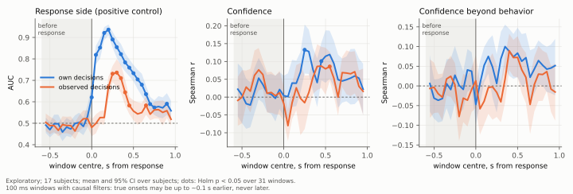
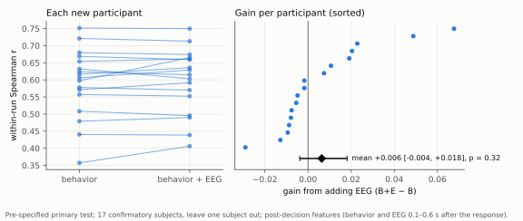
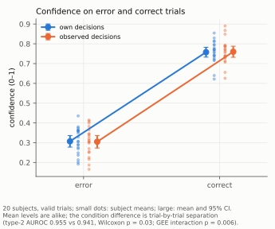
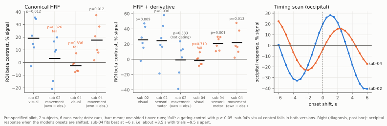
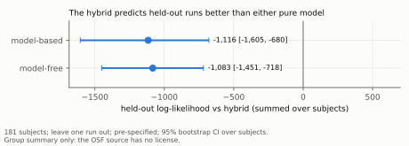
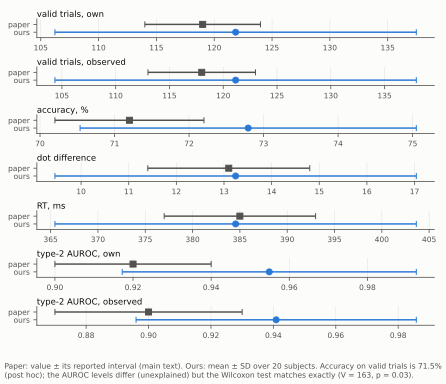

# Research report: latent-decision-models v0.1.1

- **Date:** 2026-11-25
- **Software:** `latent-decision-models` 0.1.1 (Python ≥ 3.10; tested on 3.11 in CI and 3.12 locally)
- **Scope:** confidence after committed vs observed decisions (OpenNeuro ds002158: behavior, EEG and fMRI from the same session) and belief updating in a two-step task (OpenNeuro ds007474, behavior).

This page brings together every result in the repository, each with its evidence level and the file that holds the numbers. The detailed pages in `docs/` hold the full methods, the caveats and the commands.

## Evidence levels

| Level | Meaning |
| --- | --- |
| **Confirmatory** | Plan committed before the data in question were analysed, on subjects not used to build the pipeline |
| **Pre-specified** | Plan and decision rule committed before the analysis, but related results on the same data were already known |
| **Exploratory / post hoc** | Chosen or interpreted after seeing related results; hypothesis-generating only |

Every claim below is no stronger than its level. All neural features used for confidence are **post-decision** (or whole-trial for fMRI). None is a prospective prediction.

## ds002158: confidence after one's own and observed decisions

**Data checks.** These are facts about the dataset, verified against the files ([audit](ds002158-audit.md)).
- Behavior is aligned to the fMRI volumes with 0.0 ms residual. 109 of 111 EEG runs pair with their events by marker timing.
- **sub-12's EEG run filenames are shifted**, so filename pairing would mislabel its trials.
- **sub-20's events and EEG markers disagree on response side.** sub-20 is excluded from all neural analyses.
- Raw EEG headers name the original lab files, so the published recordings do not open as is. MR gradient and heartbeat artifacts are still present.
- Observed trials are shuffled replays of the participant's own preceding active block.
- The "fmriprep" derivative is SPM DARTEL output (MNI, 1.5 mm, 5 mm smoothing) with TR = 0 in the headers ([fMRI audit](ds002158-fmri-audit.md)).

| Finding | Estimate | Level | Source |
| --- | --- | --- | --- |
| Behavior predicts confidence in new participants, mostly via accuracy | MAE 0.136 [0.122, 0.152] vs null 0.222; ρ = 0.59 | Pre-specified | [baseline](ds002158-behavioral-baseline.md) |
| Confidence tracks accuracy less steeply for observed decisions | GEE interaction −1.73 [−2.95, −0.51], p = 0.006 | Post hoc | [baseline](ds002158-behavioral-baseline.md) |
| A second-order SDT model cannot tell whether observed choices are evaluated as one's own | Δ log-likelihood (held-out runs) +19 [−60, +99]; ρ not identifiable per subject | Pre-specified, with recovery | [model](ds002158-confidence-model.md) |
| EEG positive control: response side decodes at and after the response, not before | Within subject, AUC 0.73 at the response and 0.93 after it (17/17 subjects); left-out subjects 0.69 / 0.82; pre-decision 0.51 | Confirmatory | `reports/ds002158-eeg-decoding-confirmatory.json` |
| **Confidence decodes from EEG 0.1–0.6 s after one's own response** | Within subject r = 0.16 [0.10, 0.22], Holm p = 0.0009 (16/17); left-out subjects r = 0.10 [0.05, 0.15], Holm p = 0.005 | **Confirmatory** (17 new subjects) | same |
| … but not before the decision, and not reliably for observed decisions | Pre-decision r = −0.00; observed r = 0.05, Holm p = 0.18 | Confirmatory | same |
| The EEG confidence signal is mostly shared with behavior | Beyond accuracy, latency and evidence: within r = 0.08 (p = 0.013, uncorrected); left-out subjects r = 0.01 | Confirmatory (secondary) | same |
| Heartbeat timing does not explain it | Beyond cardiac timing: within r = 0.155, Holm p = 0.005 | Post hoc | `reports/ds002158-eeg-decoding-cardiac-control-aas.json`, [EEG](ds002158-eeg.md) |
| Artifact-removal choice matters for transfer to new subjects; a planted-signal test predicted which choice | OBS with 4 components removes ~half of a slow signal (transfer r = 0.04); OBS with 1 component: r = 0.11, Holm p = 0.006 | Post hoc, with a prediction made before decoding | `reports/ds002158-eeg-bcg-retention.json`, `…-confirmatory-obs1.json` |
| The own-decision signal does not transfer to observed decisions | Own → observed r = −0.04; observed → own r = 0.01 | Pre-specified (exploratory) | `reports/ds002158-eeg-own-vs-observed-aas.json` |
| **Post-decision EEG adds no measurable information beyond behavior in new participants** | Behavior r = 0.59; gain from EEG +0.006 [−0.004, 0.018], p = 0.32; EEG alone r = 0.08, Holm p = 0.012 | **Pre-specified** | `reports/ds002158-fusion.json`, [fusion](ds002158-fusion.md) |
| A small PyTorch fusion network is not better than linear stacking | −0.05 [−0.09, −0.01], Holm p = 0.08 | Pre-specified | same |
| **Trial-level fMRI from the published derivative failed its positive controls** | Each pilot subject failed one control; with HRF derivatives, sub-04 visual still fails (p = 0.71) | Pre-specified (2 subjects); diagnosis post hoc | `reports/ds002158-fmri-*.json`, [fMRI pilot](ds002158-fmri-pilot.md) |

**Summary:**
- After one's own decisions, a confidence-related EEG signal appears 0.2–0.6 s after the response. It generalises to new participants.
- It adds little or nothing to what accuracy, evidence and response latency already say about confidence.
- It does not carry over to decisions the participant only observed. With these data, movement-related activity cannot be separated from evaluation of one's own commitment.
- No fMRI confidence result exists. In this near-periodic design (trials ~9.5 s apart), single-trial fMRI amplitudes were dominated by response latency.

### Figures

*Within-subject EEG decoding in 100 ms windows around the response (exploratory time course). Response side, the positive control, rises at the response. Confidence appears about 0.2–0.6 s after one's own response, and later and more weakly for observed decisions. No window before the response survives correction.*

*Adding post-decision EEG to behavior barely changes the prediction of confidence in any new participant (pre-specified primary test).*

*Mean confidence is alike for own and observed decisions. The difference between them lies in how well confidence separates correct from error trials, one trial at a time.*

*The trial-level fMRI pilot. A gating control fails in each version, so no fMRI confidence analysis was run.*

## ds007474: model-based and model-free learning in a two-step task (behavior)

**Data checks** ([audit](ds007474-audit.md)):
- All 378 BIDS `events.tsv` files are header-only. Behavior and timing come from OSF and map one-to-one onto the BIDS subjects.
- Every shown outcome is reproduced from the stored schedule: 0 mismatches in 28,512 trials.
- The OSF project declares **no license**, so no derived real-data outputs are stored in this repository. The exceptions are group summary statistics: the numbers below and one figure of them. The numbers are documented in [RL models](ds007474-two-step-model.md) and can be regenerated with the commands there.

| Finding (181 subjects) | Estimate | Level |
| --- | --- | --- |
| A model-free/model-based hybrid predicts held-out runs better than either alone | Δ log-likelihood vs MF +1,083 [718, 1,451]; vs MB +1,116 [680, 1,605] | Pre-specified, with recovery |
| The model-based weight does not reliably depend on which strategy is rewarded | Order-balanced Δw −0.012 [−0.047, 0.023] (scanner); +0.032 [−0.006, 0.072] (separate session); a planted 0.15 effect is recovered | Pre-specified |
| Win-stay/lose-shift terms fix the hybrid's misfit and predict a separate session better | +318 [194, 454] (separate session) | Exploratory, replicated out of session |
| No evidence for trial-wise arbitration: the sign of the "stakes" effect depends on the assumed learning signal | −0.27 (win/no-win learning) vs +0.56 (points), both calibrated Holm p < 0.05 | Pre-specified exploratory; no claim |
| Hierarchical (empirical-Bayes) fitting improves recovery and prediction of a separate session; ranking unchanged | +97 [56, 141] | Pre-specified |

*Group summary only (181 subjects; leave one run out). The hybrid + contingency model is not shown, because its run-held-out score cannot be interpreted (see [RL models](ds007474-two-step-model.md)).*

## Null and negative results (reported, not hidden)

- **Fusion:** adding post-decision EEG to behavior gives no measurable gain (pre-specified primary test).
- **fMRI:** trial-level fMRI was closed after two pre-specified pilot attempts.
- **Confidence model:** no mechanistic claim about how observed decisions are evaluated; ρ is not identifiable.
- **ds007474:** no contingency effect on the model-based weight, and no separable arbitration effect.
- **Transfer:** the EEG confidence signal does not transfer between own and observed decisions.

## Methods common to all analyses

- **Planning:** plans and decision rules are committed to git before the analysis. Every amendment is dated and says whether it came before or after the results.
- **Evaluation:** subject-disjoint (leave-one-subject-out or grouped folds) and/or run-held-out within subject; no subject appears in both training and test. Scalers, hyper-parameters and stacking layers are fitted inside training folds.
- **Model checks:** recovery studies on synthetic data (real task schedules where relevant) come before model comparisons, and calibrated nulls are used where plain tests were biased.
- **Time windows:** neural windows are labelled pre-decision, response-locked or post-decision. Pre-decision features use causal filters.
- **Signal downloads:** each needs an explicit size budget and keeps a disk reserve. Raw and derived participant data are not committed; the exception is a minimal CC0 test fixture.

## External check

Our ds002158 behavioral results agree with the original publication (Pereira et al. 2020) on every comparable inferential result, including an exact match of the type-2 AUROC test (V = 163, p = 0.03). The type-2 AUROC levels are ~0.04 higher and unexplained. EEG onsets differ by ~50–100 ms, consistent with opposite filtering directions. For ds007474, every comparable verbatim result of the study's preprint is reproduced: transition rate, reward-probability check (47.12% vs 47.19%; null 43.09% vs 43.08%), the reward and model-based stay effects, and the hybrid beating pure MF and MB. **Clean-room reproduction:** every committed ds002158 report regenerates within 1e-6 from a fresh clone and environment, using hash-checked data. The ds007474 primary model comparison regenerates within optimizer tolerance (about 1e-5). The drift is traced to one floating-point rewrite of the prior term, and no published number changes. Details: [validation](VALIDATION.md).

## Limitations

- **ds002158** has 20 subjects (17 in the confirmatory EEG set). Effects of r ≈ 0.1 are near what this sample can resolve, and increments of about 0.01 cannot be resolved.
- **EEG** comes from an MR scanner. Results depend on artifact removal, and only template subtraction and OBS variants were compared.
- **Behavior and EEG** were modelled with classical linear decoders and one small network on one window. Time-frequency features were not tested.
- **ds007474** results are behavioral only. Its fMRI would need preprocessing of 259 GB of raw BOLD.
- **Single lab per task:** each task comes from one lab, so no result has been replicated in an independent dataset.

## Reproducibility

- **Environment:** `pip install -e '.[dev,eeg,fmri,deep]'`. Exact versions used for the reported runs are in [`requirements-lock.txt`](../requirements-lock.txt) (Python 3.12, macOS, CPU).
- **Data:** OpenNeuro ds002158 v1.0.2 and ds007474 v1.0.5 (CC0); ds007474 behavior from OSF `ctfzd` (no license; fetched by allow-listed, hash-checked download). Signal downloads are explicit (`fetch-eeg`, `fetch-fmri`).
- **Figures:** `ldm figures --trials data/ds002158_trials.csv` (needs `[plots]`) redraws `docs/figures/` from the reports. A test checks that the committed figures match a fresh build.
- **Commands:** in the README and on each detailed page. Every committed JSON report records the config that produced it.
- **Tests:** 210 automated tests. They use synthetic data and the CC0 fixture, and run without neuroimaging data. CI runs the base suite plus separate jobs for the `[eeg]`, `[fmri]` and `[deep]` extras. `tests/test_report.py` checks that the ds002158 headline numbers on this page match the committed reports.
