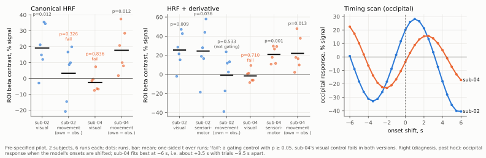

# ds002158 trial-level fMRI pilot (2 subjects)

- **Date:** 2026-11-24
- **Data:** published derivative images (`derivatives/fmriprep/*_preproc.nii`, SPM DARTEL, MNI 1.5 mm, 5 mm smoothing) and realignment parameters for **sub-02 and sub-04**, 6 runs each (38.0 GB, SHA-256 recorded at download).
- **Plan:** [`configs/ds002158_fmri_pilot.yaml`](../configs/ds002158_fmri_pilot.yaml), committed before any image was opened. Subjects were chosen by a rule on inventory and motion only.
- **Reports:** [`reports/ds002158-fmri-lss-qc.json`](../reports/ds002158-fmri-lss-qc.json) (per-run QC), [`reports/ds002158-fmri-pilot.json`](../reports/ds002158-fmri-pilot.json) (positive controls), [`reports/ds002158-fmri-timing.json`](../reports/ds002158-fmri-timing.json) (timing diagnostic, added after the controls failed).

## Result in one paragraph

Image quality is good. However, the pre-specified pipeline checks failed: each subject failed one of the two positive controls. Under the plan, the confidence analysis was therefore **not run**. A timing diagnostic, added afterwards and so post hoc, explains the visual failure. In sub-04 the occipital response is out of phase with the canonical HRF at the recorded stimulus onsets. Trials repeat every ~9.5 s, so a canonical-HRF beta from this design depends strongly on response latency. Single-trial betas from a canonical stick function at stimulus onset are therefore not a dependable feature for this dataset as specified. Any continuation needs a revised, latency-robust plan (options below). **Update: a revised plan with derivative-boosted amplitudes (option 1) also failed in sub-04 (see Revision 1). Trial-level fMRI for ds002158 is recommended to be closed.**

## Quality (12 runs)

| Quantity | Range over runs |
| --- | --- |
| Trials per run | 48 |
| ROIs (Harvard-Oxford cortical L/R + subcortical grey matter) | 111, none empty |
| ROI temporal SNR, median | 165–276 (minimum ROI 47–88) |
| LSS design condition number (unit-norm columns), max | 9–76 |
| Mean framewise displacement | 0.14–0.19 mm |
| Volumes with FD > 0.5 mm | 0–3.7% |

## Pre-specified positive controls (failed)

Each control uses a one-sided t-test over the 6 run means; a check holds at p < 0.05. Betas are in percent signal per unit nilearn regressor.

| | Visual: all valid trials > 0, occipital | Movement: active > observed, pre/postcentral |
| --- | --- | --- |
| sub-02 | mean 19.2, t = 3.22, **p = 0.012** (5/6 runs > 0) | mean 3.3, t = 0.48, p = 0.33 (4/6 runs > 0) |
| sub-04 | mean −2.5, t = −1.09, p = 0.84 (1/6 runs > 0) | mean 17.7, t = 3.20, **p = 0.012** (6/6 runs > 0) |

Decision (plan, item 2): stop and investigate; no confidence decoding.

## Investigation (post hoc; event timing and ROI time series only, no confidence data)

1. **Is the visual check identifiable at all?** Yes. The all-trials regressor shares only 1–2% of its variance with intercept + drift (R² = 0.012–0.024 over all 118 runs).
2. **Is the movement check identifiable?** Partly. Active and observed blocks alternate every ~105 s, near the 128 s high-pass cut-off, so 29–36% of the active − observed regressor is explained by the drift terms. This weakens the check. The plan should have caught it.
3. **Trial timing is nearly periodic.** Onset gaps: median 9.52 s, 90% ≤ 10.02 s, minimum 8.99 s. Only block breaks (13–14 s) interrupt the rhythm. A response arriving a quarter period (~2.4 s) later than the model predicts therefore gives a canonical beta near zero; half a period gives a negative one.
4. **Onset-shift scan** (`ldm ds002158 fmri-timing`). An all-trials regressor is fitted with the onsets shifted by −6 to +6 s; the best positive fit is reported:

| | Occipital | Sensorimotor |
| --- | --- | --- |
| sub-02 | +0.5 to +1.5 s in 5/6 runs | +0.5 to +2 s in 6/6 runs |
| sub-04 | −6 s (edge of the window) in **6/6 runs**; with a ~9.5 s period this is equivalent to about +3.5 s | +1 to +2.5 s in 5/6 runs |

   In sub-04 the occipital signal follows a consistent but later phase than the canonical HRF at stimulus onset predicts. This is enough to cancel the canonical beta, so the visual failure is a timing mismatch, not an absent response. The cause cannot be identified from this design. Candidates: visual events later in the trial (the confidence scale), subject-specific HRF latency, or unrecorded slice timing (at most ~1 TR). Data from two subjects cannot say how common this is.

The FIR (finite impulse response) estimate of the evoked response is not informative here: with trials every ~7.4 volumes, lags beyond one period are nearly aliased.



## What this means

- The published derivative is usable: good tSNR, consistent volumes and motion.
- The specific feature planned (one canonical-HRF stick beta per trial at stimulus onset) is fragile in this near-periodic design. A latency mismatch of 2–4 s, seen in one of two subjects, removes or inverts the average response. Single-trial confidence features built this way could be dominated by timing rather than amplitude.
- **No confidence result exists from fMRI.** Nothing here supports or contradicts a neural confidence signal.

## Options (need a decision; each would be a new plan written before analysis)

1. **Latency-robust single-trial estimates:** LSS with the HRF time (and dispersion) derivative, taking the derivative-boosted amplitude per trial. Re-run the same positive controls, plus a design-appropriate movement check (e.g. without the block-level contrast). Cheapest: uses the 2 downloaded subjects.
2. **Subject-specific HRF latency** estimated from data, e.g. across all trials of a held-out run. Raises fold-leakage concerns; more complex.
3. **Stop fMRI work for ds002158.** Keep the EEG results as the neural evidence and use the remaining effort elsewhere. This frees 38 GB.

Downloading more subjects (19 GB each) is not recommended until one of options 1–2 passes the controls on the pilot.

## Revision 1: latency-robust amplitudes (option 1, chosen 2026-11-25)

**Plan:** [`configs/ds002158_fmri_pilot_derivative.yaml`](../configs/ds002158_fmri_pilot_derivative.yaml), committed before the analysis. It was not blind: the first pilot's results and the timing scan were known.
- **Feature:** each trial was modelled with the Glover HRF plus its time derivative. The target derivative was orthogonalised against the canonical regressor and scaled to its norm. The amplitude is derivative-boosted, sign(b_canonical) × √(b_canonical² + b_derivative²) (Calhoun et al. 2004).
- **Gating controls:** visual (as before) and sensorimotor response on active trials. The active − observed contrast was demoted to descriptive because of the high-pass problem.
- **Stated expectation:** the derivative absorbs latency errors of about ±1–2 s, so sub-04's ~3.5 s occipital lag might still fail.
- **Synthetic check:** at a 1 s delay, the boosted amplitude has a median error of 0.12, against 0.21 for the canonical beta.
- **Source:** amplitudes were computed from the saved ROI time series. Rebuilding the canonical betas this way reproduces the first pilot exactly (maximum difference 0).

**Report:** [`reports/ds002158-fmri-derivative-pilot.json`](../reports/ds002158-fmri-derivative-pilot.json); QC in [`reports/ds002158-fmri-derivative-lss-qc.json`](../reports/ds002158-fmri-derivative-lss-qc.json).

| | Visual (gating) | Sensorimotor, active trials (gating) | Active − observed (descriptive) |
| --- | --- | --- | --- |
| sub-02 | mean 25.5, t = 3.44, **p = 0.009** (5/6 runs > 0) | mean 24.5, t = 2.28, **p = 0.036** (5/6) | −0.8, p = 0.53 |
| sub-04 | mean −1.6, t = −0.59, p = 0.71 (3/6) | mean 20.9, t = 5.90, **p = 0.001** (6/6) | 22.0, p = 0.013 |

**Outcome:** sub-04's visual control fails again, as anticipated in the plan. Its sensorimotor responses are now clear in every run, so the method works where the latency error is small. Occipital cortex in sub-04 is out of the derivative's range. By the plan's rule, the decoding was not run.

## Conclusion and recommendation

Two pre-specified attempts failed to give trial-level fMRI features that pass basic checks in both pilot subjects. The cause appears to be specific to this dataset. Trials come every ~9.5 s with little jitter, so single-trial amplitudes depend strongly on response latency. That latency differs between regions and subjects by more than a time derivative can absorb.

**Recommendation: close trial-level fMRI work for ds002158** (option 3). Do not download more subjects. Keep the EEG results as the neural evidence for this dataset. Deleting the 38 GB of pilot images is the user's decision; the ROI time series (a few MB) are kept, so all reported numbers can be regenerated.

Not tried, because each would be a further post hoc rescue on the same two subjects:
- region-specific latency fitting (option 2);
- FIR or phase-based single-trial models.

These are reasonable only with a fresh, independent subset of subjects for confirmation.

## Reproduce

```bash
pip install -e '.[fmri]'
ldm ds002158 fetch-fmri --subjects sub-02 sub-04 --dest data/ds002158 --approved-gb 38.1
ldm ds002158 fmri-lss --config configs/ds002158_fmri_pilot.yaml --report reports/ds002158-fmri-lss-qc.json
ldm ds002158 fmri-pilot --config configs/ds002158_fmri_pilot.yaml --out reports/ds002158-fmri-pilot.json
ldm ds002158 fmri-timing --config configs/ds002158_fmri_pilot.yaml --out reports/ds002158-fmri-timing.json
# revision 1 (reuses the saved ROI time series; no image read)
ldm ds002158 fmri-lss --config configs/ds002158_fmri_pilot_derivative.yaml --report reports/ds002158-fmri-derivative-lss-qc.json
ldm ds002158 fmri-pilot --config configs/ds002158_fmri_pilot_derivative.yaml --out reports/ds002158-fmri-derivative-pilot.json
```

`fmri-lss` takes ~6 min per run from an external disk. It saves ROI time series to `<out-dir>/roi_ts/`, which `fmri-timing` reads. In this pilot the time series were extracted by an equivalent script before `fmri-lss` saved them: same functions, same file format.
