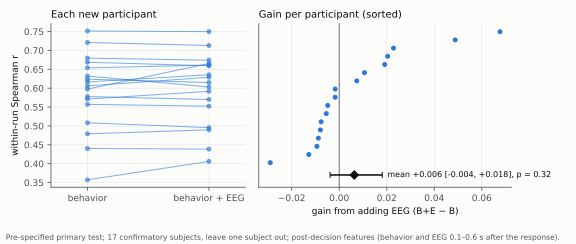

# ds002158: does post-decision EEG add to behavior in predicting confidence? (LDM-005)

- **Date:** 2026-11-25
- **Plan:** [`configs/ds002158_fusion.yaml`](../configs/ds002158_fusion.yaml), committed before any fusion model was fitted (commit ccb8cd9). One amendment was made before any real-data fit: training targets are centred within runs (see Method).
- **Report:** [`reports/ds002158-fusion.json`](../reports/ds002158-fusion.json): group tests and per-subject scores.
- **Scope:** re-scoped from fMRI + EEG fusion after trial-level fMRI for this dataset was closed ([fMRI pilot](ds002158-fmri-pilot.md)).

## Result

**No.** In new participants, adding post-decision EEG to behavior did not improve the prediction of confidence after one's own decisions. The gain was +0.006 in within-run Spearman r, 95% CI [−0.004, 0.018], one-sided Wilcoxon p = 0.32, 17 subjects. EEG on its own does carry confidence information in new participants (r = 0.083 [0.034, 0.131], Holm p = 0.012), but behavior alone already reaches r = 0.59. The EEG information is therefore largely redundant with accuracy, evidence and response latency. A small nonlinear network was not better than the linear combination; it was nominally worse (−0.05, Holm p = 0.08).

All features are available only after the first-order response. These are post-decision models of the confidence report, not prospective predictions.

## Method (as pre-specified)

- **Subjects and trials:**
  - 19 subjects were loaded. sub-02 and sub-04 serve as training data only; group tests use the 17 confirmatory subjects. sub-20 is excluded (label conflict).
  - Trials are valid, have an EEG epoch that was not rejected and a response marker, and have confidence and all behavior columns. Every model uses the same trials: 72–138 own-decision trials per subject, 2,010 in total for the confirmatory subjects.
- **Behavior (B):** accuracy, evidence (dots difference), response latency, accuracy × evidence, accuracy × latency.
- **EEG (E):** 0.1–0.6 s after the response, 50 ms bin means, all good channels: 620 features (62 channels × 10 bins; the plan's "~300" was an estimate). Epochs are cleaned by template subtraction (hb-aas), as in the confirmatory EEG analysis.
- **B+E (stacked):**
  - A ridge model on E is fitted inside the training data. Its out-of-fold predictions there are made with inner folds over the training subjects, or the training runs within a subject.
  - Those predictions, and the EEG model's prediction for the test data, enter a ridge model together with B.
- **MLP (PyTorch):**
  - Architecture: E goes through an 8-unit linear layer and is concatenated with B, then 16 ReLU units with dropout 0.2, then one output.
  - Training: AdamW, early stopping on 2 training subjects held out for validation, mean of 5 seeds.
  - Scope: participant-disjoint, own decisions only.
- **Evaluation:**
  - Leave one subject out (primary) and leave one run out within subject.
  - Score: Spearman r within each held-out run, averaged over runs.
  - Every scaler and hyper-parameter is fitted on training data only.
- **Amendment before the real-data fit:** training targets are centred within each training run, for every model. Without it, synthetic tests showed run-to-run offsets in confidence leaking into the stacked model through biased out-of-fold predictions; B+E scored 0.22 *below* B. With it, on data where EEG carries nothing, the B+E − B gain averages −0.0002 ± 0.0003 over 20 replicates.

## Results

Mean within-run Spearman r over the 17 confirmatory subjects:

| Condition | Evaluation | B | E | B+E | MLP |
| --- | --- | --- | --- | --- | --- |
| own decisions | new participants | 0.591 | 0.083 | 0.597 | 0.545 |
| own decisions | within subject | 0.572 | 0.164 | 0.570 | – |
| observed decisions | new participants | 0.566 | 0.048 | 0.557 | – |
| observed decisions | within subject | 0.538 | 0.050 | 0.538 | – |

Group tests:

| Role | Test | Mean [95% CI] | Subjects > 0 | p | Holm p (secondary) |
| --- | --- | --- | --- | --- | --- |
| **primary** | own, new participants: B+E − B | +0.006 [−0.004, 0.018] | 7/17 | 0.32 | – |
| secondary | own, within subject: B+E − B | −0.004 [−0.022, 0.016] | 6/17 | 0.84 | 1.0 |
| secondary | observed, new participants: B+E − B | −0.015 [−0.031, −0.000] | 6/17 | 0.95 | 1.0 |
| secondary | observed, within subject: B+E − B | −0.003 [−0.019, 0.014] | 8/17 | 0.66 | 1.0 |
| secondary | own, new participants: MLP − B+E (two-sided) | −0.052 [−0.088, −0.014] | 4/17 | 0.020 | 0.081 |
| secondary | own, new participants: E > 0 | 0.083 [0.034, 0.131] | 14/17 | 0.0023 | **0.012** |



## Interpretation

- **Consistency with the EEG results.** The earlier within-subject decoder of confidence *residualised* on behavior reached r = 0.08 ([EEG](ds002158-eeg.md), uncorrected p = 0.013), about 0.7% of the residual variance. (The plan's comment and the first version of this page wrongly quoted r = 0.16, the plain confidence decoder; corrected 2026-11-25.) Behavior already explains about 35% of the variance here (r ≈ 0.59), so at best EEG could lift the total correlation by roughly +0.004. The observed gains (+0.006 in new participants, −0.004 within subject) are of that order. The null result is therefore informative about size: post-decision EEG adds **at most a very small** increment to behavior in this dataset. It does not show that there is none.
- **The nonlinear model** overfits with ~1,900 training trials and 620 EEG features; the linear stacked model is the better fusion baseline here.
- **Not shown:** whether other EEG features (time-frequency, longer windows into the rating period) or other cleaning would add more. Any such test would be exploratory on these data.

## Reproduce

```bash
pip install -e '.[eeg,deep]'
ldm ds002158 fusion --config configs/ds002158_fusion.yaml --epochs-dir data/derivatives/hb-aas \
    --out reports/ds002158-fusion.json --predictions data/derivatives/ldm-fusion
```

The epochs come from `ldm ds002158 eeg-preprocess --bcg-method aas` ([EEG](ds002158-eeg.md)).
