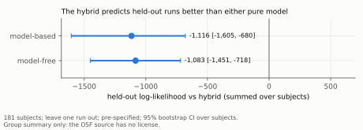

# ds007474: model-free / model-based reinforcement learning (behavior only)

- **Date:** 2026-11-19
- **Data:** ds007474 v1.0.5 behavior from OSF [`ctfzd`](https://osf.io/ctfzd), functional-run trials only (2 runs × 77 per subject). See the [audit](ds007474-audit.md).
- **Code:** [`latent_decision_models.two_step_model`](../src/latent_decision_models/two_step_model.py); CLI `ldm two-step-model recovery|compare`.
- **Reports:** recovery JSONs are committed:
  - [synthetic schedules](../reports/two_step_recovery.json), [real schedules](../reports/two_step_recovery_real_schedules.json), [fitted range](../reports/two_step_recovery_fitted_range.json);
  - [extended models](../reports/two_step_recovery_extended.json), [extended models, fitted range](../reports/two_step_recovery_extended_fitted_range.json), [structural session](../reports/two_step_recovery_structural.json). Real-data outputs are regenerated locally (`reports/ds007474_two_step_model*.json`, git-ignored).

## Summary

- **The task design is now fully verified.** Every shown outcome is reproduced from the trial schedule stored in the CSV (0 mismatches on 28,512 responded trials). Any agent can therefore be replayed on each subject's real task sequence.
- **Hybrid beats pure model-free and pure model-based learning on held-out data.** On held-out runs, hybrid beats MF by 1,083 log-likelihood units [718, 1,451] and MB by 1,116 [680, 1,605], summed over 181 subjects. The ranking is the same on held-out subjects, with learning from points instead of wins, and with no exclusions. Recovery over the fitted parameter range shows this group-level comparison is not biased toward the hybrid.
- **No reliable evidence that people weight model-based control more when it pays off.** The design switches between reward contingencies where model-based control is correct (state) or useless (stimulus).
  - The order-balanced difference w_state − w_stimulus is −0.012 [−0.047, 0.023] in the scanner session.
  - It is +0.032 [−0.006, 0.072] in the separate structural session.
  - A planted effect of 0.15 is recovered (0.11 and 0.09 respectively), so an effect of that size would have been seen.
- **The larger stay interaction under state contingency comes from the schedule, not from arbitration.** Observed: 0.26 vs 0.21. The hybrid with one weight reproduces the same 0.05 difference.
- **Follow-up (after the primary analysis):** adding one-trial win-stay/lose-shift terms fixes the misfit of the four primary models, which underpredict the reward × transition interaction. The extended model (`hybrid_wsls`) predicts better in three ways:
  - **held-out runs:** +400 [61, 721];
  - **held-out subjects:** −0.580 vs −0.595 per trial;
  - **a separate session:** +318 [194, 454].

  Separate MF/MB learning rates add nothing. See "Follow-up".
- **Follow-ups 2 and 3 (trial-wise arbitration; plans committed before fitting):** no evidence for arbitration by stakes or by state uncertainty.
  - With win-based model-free learning, the model-based weight is lower after high-stakes trials (−0.27 [−0.44, −0.10]; calibrated Holm p = 0.02; −0.25 in the other session).
  - With points-based model-free learning, the same weight is *higher* (+0.56, Holm p = 0.04; +0.49 in the other session).
  - The sign depends on the assumed learning signal, so the stakes effect cannot be separated from how strongly model-free learning scales with points. State uncertainty has no effect under either assumption. See "Follow-up 3".
- **Follow-up 4 (hierarchical fitting):** empirical-Bayes fitting recovers parameters better than the fixed prior and predicts the separate session better (+97 [56, 141] for `hybrid_wsls`). The model ranking does not change. See "Follow-up 4".

These are descriptive model comparisons on one dataset; they are not new claims about the brain.

## Task facts used by the model (verified on all 189 subjects)

Verified against the authors' task code (`task_code/` in `Gentu-Ding/2-step-task-MBMF-fMRI-code`, read but not copied) and checked on every file:

| Fact | Evidence |
| --- | --- |
| **Ship → planet:** the left ship commonly (70%) reaches planet 1 (pads 1–2) and the right ship planet 2 (pads 3–4). There is no second-stage choice. | Crosstab of choice × common planet: 100% / 100%. |
| **`state2_1`, `state2_2`:** the pad each ship would reach on that trial. | `outcome2 == state2_{Resp1}` on 100% of responded trials. |
| **`rewBinary_k`:** this trial's win draw for pad k. `rewPWin_k` is its probability, shared by the two pads of a planet. | `rewPWin_1 == rewPWin_2`, `rewPWin_3 == rewPWin_4` everywhere. |
| **State contingency:** the win is the draw of the pad reached. | 100% of trials. |
| **Stimulus contingency:** the win is pad 1's draw for the left ship and pad 3's for the right ship, wherever the ship landed. | 100% of trials. |
| **Points shown:** `outcomeMag = round(win × rewMagnitude × 100)`. | 100% of trials. |
| **`condState`:** sets P(common pad \| planet) to 0.5 (code 1, "high" state uncertainty) or 0.9 (code 2). It works in 26-trial blocks. | Code `pTrans([LOW HIGH]) = [0.9 0.5]`. Empirical within-block max pad share: 0.62 vs 0.89. |
| **`condReward`:** sets the magnitude scale to U(0.30, 1.00) (code 1) or U(0.10, 0.19) (code 2). It works in 26-trial blocks offset by 13 trials. | Observed ranges 0.30–1.00 and 0.10–0.19. |
| **`isPost_ContState` / `isPost_StateLow` / `isPost_RewHigh`:** the *previous* trial's condition (state contingency / `condState` = 2 / `condReward` = 1). They are NaN on the first trial of a run. | Equal to the one-trial lag on 100% of trials. |
| **Reward probabilities:** reverse 7 times per session. After each reversal they start near 0/1 and settle at 0.3 vs 0.5 within about 6 trials. | Data and code (`defineRewardProbability.m`). |
| **Contingency:** **switches once, at the run boundary.** Run 1 is 100% one contingency and run 2 98.7–100% the other. 100 subjects start stimulus-contingent and 89 state-contingent. | Data. |

The adapter now enforces these rules on every file (`reward_rule`, `magnitude_rule`, `pad_rule`, `probability_sharing` checks). It also exposes the schedule as columns: `pad_if_left`, `pad_if_right`, `reward_draw_pad1..4`, `reward_probability_planet1/2`, `magnitude_scale` and `pad_transition_probability`.

## Models

All four models share one set of rules:
- **Values** reset at the start of each run, as in the authors' model.
- **Learning:**
  - MF updates the chosen ship: `Q_mf(a) += α (r − Q_mf(a))`.
  - MB updates the planet reached: `V(s) += α (r − V(s))`, and values each ship as `Q_mb(a) = 0.7 V(common planet) + 0.3 V(other)`.
- **Choice:** `P(a) ∝ exp(β (w Q_mb + (1−w) Q_mf) + stick · [a = previous choice])`.

| Model | Free parameters |
| --- | --- |
| `mf` (w = 0) | α, β, stick |
| `mb` (w = 1) | α, β, stick |
| `hybrid` | α, β, w, stick |
| `hybrid_contingency` | α, β, w_stimulus, w_state, stick |

**Fitting:** MAP with an N(0, 2.5²) prior on the unconstrained parameters (logit / log / identity). This matches the scale of the authors' N(0, 6.25) prior. Each fit uses L-BFGS-B with 4 starts.

**Simplifications compared with the authors' 12-parameter model** (`model_getLLE_magMF_binMB_...m`), which has separate MF and MB learning rates, magnitude-based MF and binary MB learning, learned pad transitions, win-stay/lose-switch terms and trial-wise arbitration:
- One learning rate.
- The same reward signal for MF and MB.
- Fixed, instructed transitions.

This is a reference benchmark, not a replication of their model.

## Pre-specified analysis choices (fixed before any real-data fit)

| Choice | Primary | Sensitivity |
| --- | --- | --- |
| Trials | functional runs only (154 per subject) | — |
| Reward signal | win / no win | points shown / 100 |
| Fast responses (RT < 150 ms, 658 trials) | update values (the outcome was shown) but are not scored | all scored |
| Subjects | exclude > 10% missed functional trials (8 subjects; 181 kept) | all 189 |
| No-response trials | no update, not scored; stickiness refers to the last choice made | — |

## Validation before real data

All recovery used the real 189 task schedules, with each subject's real missed trials kept missing, plus synthetic schedules with the same structure. Choices were always simulated.

| Recovery study | Pearson r, true vs fitted | Group-level model recovery (disjoint groups of 10 simulated subjects, summed held-out log-lik) |
| --- | --- | --- |
| Synthetic schedules, a priori ranges | α 0.66–0.87, β 0.71–0.85, w 0.88, w_stim 0.76, w_state 0.82, stick 0.91–0.94 | mf 9/10, mb 10/10, hybrid 6/10 (3 → mf), hybrid_contingency 6/10 |
| Real schedules, a priori ranges | α 0.79–0.90, β 0.66–0.81, w 0.79, w_stim 0.81, w_state 0.79, stick 0.87–0.95 | mf 8/10, mb 10/10, hybrid 5/10 (3 → mf), hybrid_contingency 2/10 |
| **Real schedules, fitted range** (5th–95th percentiles of real fits) | α 0.78–0.84, β 0.69–0.90, w 0.84, w_stim 0.84, w_state 0.82, stick 0.94–0.95 | **mf 10/10, mb 10/10, hybrid 9/10, hybrid_contingency 6/10 (4 → hybrid)** |

Real fits extend beyond the a priori ranges (α up to 0.95, β 0.7–14, stick down to −1.6), so the fitted-range study is the relevant one.

**Per-subject model selection is unreliable** at 154 trials: for example, only 32/100 hybrid subjects are selected as hybrid. Only group-level comparisons are interpreted.

**Leave-one-run-out cannot evaluate `hybrid_contingency`.** Each run is a single contingency, so a model trained on one run has no information about the other weight. Its run-held-out score is driven by the prior; it is reported but not interpreted. The contingency question is answered by the subject-held-out comparison and the contrast below.

**Known-answer check of the contingency contrast** (one simulated subject per real schedule, fitted range):

| Planted w_state − w_stimulus | Estimate [95% CI] | Time effect estimate |
| --- | --- | --- |
| 0 | −0.019 [−0.045, 0.008] | −0.014 [−0.040, 0.011] |
| 0.15 | 0.110 [0.082, 0.137] | −0.009 [−0.037, 0.018] |

The prior shrinks the estimate by about 25%, but it detects the effect, and the time and contingency estimates do not leak into each other.

## Results (primary analysis; 181 subjects, 26,853 scored trials)

**Held-out log-likelihood per trial** (chance = −0.693):

| Model | Leave-one-run-out | Δ vs hybrid, summed [95% subject-bootstrap CI] | Subject-held-out (5-fold, pooled parameters) |
| --- | --- | --- | --- |
| hybrid | **−0.537** | — | **−0.595** |
| mf | −0.577 | −1,083 [−1,451, −718] | −0.613 |
| mb | −0.578 | −1,116 [−1,605, −680] | −0.623 |
| hybrid_contingency | −0.609 (not interpretable, see above) | −1,943 | −0.595 (= hybrid) |



**Robustness of the comparison:**
- Per-subject parameters predict held-out runs better than pooled parameters predict held-out subjects (−0.537 vs −0.595). This reflects large individual differences.
- **Sensitivity analyses:**
  - **Points** (learning from points shown): the same ranking. Hybrid vs MF is −493 [−878, −103]; hybrid vs MB is −237 [−832, +368] and does not exclude 0. Learning from win/no-win predicts choices better than learning from points (hybrid −0.537 vs −0.597 per held-out trial).
  - **No exclusions** (189 subjects): the same as the primary analysis. Hybrid vs MF is −1,114 [−1,489, −762]; hybrid vs MB is −1,210 [−1,702, −747].

**Fitted parameters (hybrid, median [IQR]):**

| Parameter | Median [IQR] |
| --- | --- |
| α | 0.82 [0.65, 0.91] |
| β | 4.2 [2.0, 7.1] |
| w | 0.58 [0.32, 0.81] |
| stick | 0.05 [−0.55, 0.45] |

Learning rates are high: choices depend mainly on the last few outcomes.

**Does the MB weight follow the contingency?** From `hybrid_contingency` per-subject fits, w_state − w_stimulus. Five subjects who only experienced state contingency (MBMF0215–0219) are excluded, because their w_stimulus is set by the prior alone.

> **Correction (2026-11-19):** the first version of this analysis included those five subjects and reported −0.003 [−0.039, 0.031]. The conclusion is unchanged.

| First contingency | n | Mean |
| --- | --- | --- |
| stimulus first | 94 | +0.021 |
| state first | 82 | −0.045 |
| **Contingency effect (order-balanced)** | 176 | **−0.012 [−0.047, 0.023]** |
| Time effect (run 2 − run 1) | | +0.033 [−0.003, 0.070] |

The result is the same with points (+0.001 [−0.039, 0.039]) and with no exclusions (−0.007 [−0.038, 0.027]). With this model and these data, there is **no evidence that participants weight model-based control more when it is the correct strategy**. The CI excludes effects around the size the known-answer check recovers.

**Posterior predictive check:** group mean P(stay) from 20 replays per subject of the fitted agent on its own schedule.

| Source | Contingency | Rewarded, common | Rewarded, rare | Unrewarded, common | Unrewarded, rare | Reward effect | Interaction |
| --- | --- | --- | --- | --- | --- | --- | --- |
| observed | state | 0.824 | 0.591 | 0.384 | 0.670 | 0.181 | 0.259 |
| observed | stimulus | 0.823 | 0.635 | 0.382 | 0.617 | 0.229 | 0.211 |
| hybrid | state | 0.800 | 0.603 | 0.436 | 0.605 | 0.181 | 0.183 |
| hybrid | stimulus | 0.791 | 0.659 | 0.425 | 0.559 | 0.233 | 0.133 |
| mf | state | 0.739 | 0.720 | 0.490 | 0.508 | 0.230 | 0.019 |
| mb | state | 0.749 | 0.450 | 0.515 | 0.694 | −0.005 | 0.239 |

- **MF and MB each miss a whole pattern.** MF shows no transition sensitivity; MB shows no reward main effect. Hybrid matches the reward main effect.
- **Hybrid underpredicts the interaction by about 0.08 in both contingencies.** People shift away after an unrewarded common transition more than the model does (0.38 vs 0.43).
- **The observed interaction is larger under state contingency** (0.259 vs 0.211). The hybrid predicts the same difference (0.183 vs 0.133) with one w, so the difference comes from the reward schedule. It is not evidence of contingency-specific arbitration.

## Follow-up: extended models and out-of-session replication

**Status:** run after the primary analysis, motivated by its posterior-predictive misfit, so it is exploratory. Settings and exclusions are those of the primary analysis (`configs/ds007474_two_step_model_extended.yaml`).

**Extended models:**
- `hybrid_2lr`: separate learning rates α_MF and α_MB.
- `hybrid_wsls`: adds one-trial win-stay/lose-shift terms to the choice rule, as in the authors' model.
  - `wsls_mf` favours repeating after a win and switching after a loss.
  - `wsls_mb` favours the ship that commonly reaches the planet that just paid off. It repeats after a win via a common transition or a loss via a rare one, and switches otherwise.
- `hybrid_2lr_wsls`: both extensions.

**Out-of-session test.** Every subject also did 105 trials in a separate session in the structural scanner. That session has no fMRI and was run before the functional session in 95 subjects and after it in 94. Each subject's parameters fitted on the two functional runs score that session. This is a stronger test than held-out runs: different session, different trial sequence, and nothing tuned on it.

**Recovery first** (real schedules; fitted range of the real `hybrid_wsls` fits; disjoint groups of 10):

| Generating model | Groups selected as: hybrid | hybrid_wsls | mf | mb |
| --- | --- | --- | --- | --- |
| hybrid | 4 | **0** | 4 | 2 |
| hybrid_wsls | 0 | **10** | 0 | 0 |
| mf | 0 | 0 | 10 | 0 |
| mb | 0 | 0 | 0 | 10 |

- **No false positives:** groups without win-stay/lose-shift are never selected as `hybrid_wsls` (0/30), and groups with it always are (10/10).
- **WSLS weights recover well:** wsls_mf r = 0.84, wsls_mb r = 0.92. Over this wider range, w recovers less well (r = 0.68–0.69), because low-β agents carry little information.
- **Separate learning rates cannot be told apart from one** at this trial count: `hybrid_2lr` groups were selected as `hybrid` 10/10 ([extended recovery](../reports/two_step_recovery_extended.json)).

**Results** (181 subjects; Δ vs `hybrid`, summed log-likelihood [95% subject-bootstrap CI]):

| Model | Held-out runs, per trial | Δ held-out runs | Held-out subjects, per trial | **Other session**, per trial | **Δ other session** |
| --- | --- | --- | --- | --- | --- |
| hybrid | −0.537 | — | −0.595 | −0.502 | — |
| **hybrid_wsls** | **−0.522** | **+400 [61, 721]** | **−0.580** | **−0.485** | **+318 [194, 454]** |
| hybrid_2lr_wsls | −0.525 | +313 [−47, 636] | −0.580 | −0.485 | +303 [175, 434] |
| hybrid_2lr | −0.541 | −111 [−167, −60] | −0.595 | −0.503 | −12 [−25, +1] |
| hybrid_contingency | (not interpretable) | | −0.595 | −0.507 | −90 [−141, −46] |
| mf | −0.577 | −1,083 | −0.613 | −0.546 | −779 [−1,020, −563] |
| mb | −0.578 | −1,116 | −0.623 | −0.556 | −949 [−1,210, −717] |

The structural session scores 17,808 trials. Per-trial values there are higher than for held-out runs, because its sequences are 105 trials long and its schedule differs; compare models within a column only.

**What the results show:**
- **Model ranking replicates out of session.** Hybrid beats pure MF and pure MB in the other session too.
- **Contingency weights don't help.** A contingency-specific weight makes out-of-session prediction worse (−90 [−141, −46]); the extra parameter only adds noise.
- **Separate learning rates add nothing,** in line with their non-recoverability.

**Fitted `hybrid_wsls` (median [IQR]):**

| Parameter | Median [IQR] |
| --- | --- |
| α | 0.63 [0.46, 0.80] |
| β | 2.8 [1.2, 4.6] |
| w | 0.52 [0.36, 0.75] |
| stick | 0.49 [−0.21, 0.94] |
| wsls_mf | 0.26 [−0.05, 0.69] |
| wsls_mb | 0.26 [−0.01, 0.89] |

Part of what the plain hybrid attributed to fast learning (α 0.82) is carried by the one-trial terms.

**Posterior predictive check (P(stay); interaction = reward × transition):**

| Source | Contingency | Rewarded, common | Rewarded, rare | Unrewarded, common | Unrewarded, rare | Interaction |
| --- | --- | --- | --- | --- | --- | --- |
| observed | state | 0.824 | 0.591 | 0.384 | 0.670 | 0.259 |
| hybrid | state | 0.800 | 0.603 | 0.436 | 0.605 | 0.183 |
| hybrid_wsls | state | 0.821 | 0.602 | 0.387 | 0.651 | 0.241 |
| observed | stimulus | 0.823 | 0.635 | 0.382 | 0.617 | 0.211 |
| hybrid | stimulus | 0.791 | 0.659 | 0.425 | 0.559 | 0.133 |
| hybrid_wsls | stimulus | 0.820 | 0.633 | 0.384 | 0.630 | 0.216 |

The win-stay/lose-shift terms remove most of the misfit: the shift after unrewarded common transitions (0.387 vs 0.384 observed) and the interaction.

**Contingency contrast in the structural session** (`hybrid_contingency` fitted to that session alone). Here the switch falls inside one 105-trial run. Seven subjects who never switch are excluded, leaving 174.

| | Estimate [95% CI] |
| --- | --- |
| stimulus first (n = 97), mean | −0.005 (Wilcoxon p = 0.72) |
| state first (n = 77), mean | +0.069 (Wilcoxon p = 0.076) |
| **Contingency effect (order-balanced)** | **+0.032 [−0.006, 0.072]** |
| Time effect | −0.037 [−0.077, +0.004] |
| Known-answer check, planted 0 | −0.025 [−0.054, +0.005] |
| Known-answer check, planted 0.15 | +0.093 [0.063, 0.125] |

- **Small bias in this session.** The simulations recover a planted 0.15, but show a small negative bias of about −0.03 in a session this short. Bias also leaks into the time estimate (−0.033 [−0.064, −0.000] with a planted 0.15).
- **Two sessions disagree slightly in direction.** The structural session points weakly toward more model-based weighting under state contingency; the scanner session points slightly the other way (−0.012 [−0.047, 0.023]). Neither CI excludes 0.
- **Conclusion:** no reliable contingency effect on the MB weight. Effects as large as 0.15 are unlikely in either session.

## Follow-up 2: trial-wise arbitration (exploratory)

**Question.** Does the model-based weight shift trial by trial with the conditions just experienced, as the authors' `isPost_*` terms assume? Two conditions alternate in ~26-trial blocks within every run:
- **state uncertainty:** pads within a planet are reliable (P = 0.9) or not (P = 0.5);
- **stakes:** high (magnitude scale 0.30–1.00) or low (0.10–0.19) reward magnitude.

**Model** (`hybrid_wsls_arbitration`): `hybrid_wsls` with `w_t = expit(logit(w) + arb_reliable · x_reliable + arb_high · x_high)`, where x = ±0.5 codes the previous trial's condition. Because both conditions change within runs, held-out runs are a valid test here, unlike for the contingency question. Prior work suggests both weights are positive (less state uncertainty, or higher stakes, → more model-based control; Lee et al. 2014, Kool et al. 2017); the tests are two-sided.

**Recovery first** ([report](../reports/two_step_recovery_arbitration.json); real schedules, fitted range of `hybrid_wsls`, arbitration weights up to ±1 logit unit):

| Check | Result |
| --- | --- |
| Per-subject arbitration weights, true vs fitted r | `arb_reliable` 0.32, `arb_high` 0.37 (other parameters 0.54–0.90) |
| Model comparison on held-out runs, groups of 10 | arbitration model selected in **0/10** groups when it generated the data (and 0/10 when it did not) |
| Group test, nothing planted | `arb_reliable` +0.13 [−0.00, 0.26], p = 0.046; `arb_high` −0.05, p = 0.60 |
| Group test, 0.5 / 0.5 planted | `arb_reliable` +0.34 [0.21, 0.48]; `arb_high` +0.18 [0.03, 0.33] (prior shrinkage) |

Three consequences, all fixed in the plan ([`configs/ds007474_two_step_model_arbitration.yaml`](../configs/ds007474_two_step_model_arbitration.yaml), committed in `59f17ee` before any real-data fit of this model):
- Only group-level summaries are interpretable.
- Model comparison cannot detect arbitration of this size; it is reported but cannot count as evidence either way.
- The plain group test may be biased on these schedules. The primary test is therefore **calibrated**: the observed group means are compared with a parametric-bootstrap null. For each of 100 replicates, every subject is simulated from their own fitted `hybrid_wsls` (no arbitration) on their own schedule and the arbitration model refitted (`two_step_model.arbitration_null`). An effect is claimed only if its calibrated Holm p < 0.05 and a refit on the separate structural session gives the same sign.

**Results** (181 subjects, 26,853 scored trials; real-data outputs regenerated locally, not versioned).

| Arbitration weight (logit units of w) | State uncertainty, `arb_reliable` | Stakes, `arb_high` |
| --- | --- | --- |
| Group mean, functional runs [95% CI] | +0.00 [−0.16, 0.16] (94/181 > 0) | **−0.27 [−0.44, −0.10]** (78/181 > 0) |
| Bootstrap null, mean (SD) | −0.004 (0.085) | +0.015 (0.071) |
| **Calibrated p (Holm)** | 0.93 (0.93) | **0.010 (0.020)**: beyond all 100 null replicates |
| Refit on the structural session alone | +0.02 [−0.14, 0.17], p = 0.84 | **−0.25 [−0.43, −0.06], p = 0.007** |

> **Superseded by follow-up 3:** with points-based model-free learning, the sign of this effect reverses, so it is not interpreted as arbitration.

- **Stakes: an effect by the pre-registered rule, in the unexpected direction.** After a high-magnitude trial, the model-based weight is lower, not higher. Around w = 0.5, −0.27 logit units is about 0.07 less model-based weight. The separate session shows the same sign and size.
- **State uncertainty: no effect.**
- **No estimator bias on the real fits.** The bootstrap null is centred near 0 for both terms, so the +0.13 in the recovery run was chance.

**Prediction does not improve** (Δ vs `hybrid_wsls`, summed log-likelihood): held-out runs −762 [−1,047, −510]; other session −151 [−227, −87]; held-out subjects −0.579 vs −0.580 per trial. Recovery showed that this comparison cannot detect arbitration of this size; the two extra, poorly identified parameters cost more out of sample than the effect contributes.

**Reading.** One alternative is not excluded. The models learn from win/no-win, so any extra tendency to repeat a choice after a high-points win, a magnitude-sensitive model-free effect, also appears here as "less model-based weight after high stakes". This is therefore a robust behavioural regularity (two sessions, calibrated test), not evidence for a particular arbitration mechanism. A model whose model-free learning scales with points would be the next test.


## Follow-up 3: arbitration or points-based model-free learning? (exploratory)

**Question.** Follow-up 2's effect (less model-based weight after high stakes) has a simpler possible cause. All models so far learn from win/no-win. If model-free values actually learn from the points shown, a win in a high-magnitude block (about 4× more points) moves them more. A binary-reward model can only express that as "less model-based weight after high stakes". The authors' model learns model-free values from points and model-based values from wins; `hybrid_wsls_magmf` does the same, and `hybrid_wsls_magmf_arbitration` adds the arbitration terms.

**Plan** ([`configs/ds007474_two_step_model_magmf.yaml`](../configs/ds007474_two_step_model_magmf.yaml), committed in `8a808b9` before any real-data fit of these models; post hoc to follow-up 2):
1. **Can points-based learning alone produce the effect?** Simulate every subject from their own fitted `hybrid_wsls_magmf` (no arbitration), fit `hybrid_wsls_arbitration` as in follow-up 2, 50 replicates. If the observed −0.27 lies inside this null, the learning signal is a sufficient explanation.
2. **Does arbitration remain with points-based learning?** `hybrid_wsls_magmf_arbitration`, calibrated against a null from `hybrid_wsls_magmf`, same decision rule as follow-up 2.
3. **Which learning signal predicts better?** Held-out runs and the other session.

**Recovery** ([report](../reports/two_step_recovery_magmf.json)):

| Check | Result |
| --- | --- |
| Binary vs points-based model-free learning, groups of 10 | binary groups recognised 10/10; points-based 6/10 (4 → binary) |
| Arbitration with points-based learning, nothing planted | `arb_reliable` +0.08, p = 0.48; `arb_high` +0.18 [0.03, 0.34], p = 0.046 |
| Same, 0.5 / 0.5 planted | +0.24 [0.10, 0.38]; +0.35 [0.19, 0.51] |
| Per-subject `arb_high`, true vs fitted r | 0.17 |

So a real preference for points-based learning would be informative, but a preference for binary learning would not; and only the calibrated tests decide.

**Results** (181 subjects; real-data outputs regenerated locally, not versioned).

| Stakes weight `arb_high` | Model-free learns from wins (follow-up 2) | Model-free learns from points |
| --- | --- | --- |
| Real data, functional runs [95% CI] | −0.27 [−0.44, −0.10] | **+0.56 [0.39, 0.73]** |
| Null from each subject's fitted points-based model (no arbitration), 50 replicates: mean [95%] | −0.62 [−0.73, −0.50] | +0.19 [0.06, 0.31] |
| Calibrated p (Holm over the two terms) | 0.020 (0.039) | 0.020 (0.039) |
| Refit on the structural session alone | −0.25 [−0.43, −0.06] | +0.49 [0.33, 0.66] |

`arb_reliable` (state uncertainty) is ≈ 0 in every analysis (|mean| ≤ 0.05, all p ≥ 0.39).

- **Question 1.** A learner whose model-free values follow points, fitted with win-based learning, shows an even more negative stakes weight (−0.62) than the real data (−0.27). By the plan's rule, points-based learning alone is not a sufficient explanation. It produces the effect's sign but overshoots it.
- **Question 2.** With points-based model-free learning, the stakes weight turns **positive** (+0.37 beyond its null) and keeps that sign in the other session. The rule is technically met, with the opposite sign to follow-up 2.
- **Question 3.** The two learning signals predict equally well (Δ points vs wins: held-out runs −369 [−909, +44]; other session −47 [−119, +17]). Recovery showed this comparison cannot favour win-based learning informatively.

**Reading.** The sign of the "arbitration" effect depends on what model-free learning is assumed to learn from: negative with wins, positive with points, and the data fall between the two nulls. The simplest account is that model-free learning is *partly* sensitive to reward magnitude. Each model absorbs the mismatch into the stakes term, with opposite signs. In this design, an effect of stakes on arbitration is therefore not separable from the magnitude sensitivity of learning. **Neither follow-up 2 nor this analysis is evidence for or against arbitration by stakes.** State uncertainty shows no effect under either assumption. A model with a graded magnitude sensitivity (for example, model-free reward = win × magnitude^γ) would estimate the two jointly; given the weak recovery of the arbitration weights, it may still not separate them.


## Follow-up 4: hierarchical (empirical-Bayes) fitting

**Method** (`two_step_model.fit_empirical_bayes`; `ldm two-step-model eb`). All earlier fits use a fixed, vague N(0, 2.5²) prior for every subject. Empirical Bayes estimates the group prior from the data instead (EM with a Laplace approximation; Huys et al. 2011):
- fit each subject's MAP under the current group prior N(μ, σ²) on the unconstrained parameters;
- take the posterior variance from the inverse Hessian;
- update μ and σ² from all subjects, and repeat until they change by < 0.01.

For held-out runs, the group prior is estimated on the training runs only, so held-out data never inform it.

**Recovery first** ([report](../reports/two_step_eb_recovery.json); real schedules, 189 simulated subjects, parameters drawn *uniformly* over the fitted range, so the Gaussian group prior is misspecified):

| r (true vs fitted), fixed → EB | α | β | w | stick | wsls_mf | wsls_mb | arb_reliable | arb_high |
| --- | --- | --- | --- | --- | --- | --- | --- | --- |
| `hybrid_wsls` | 0.62 → 0.70 | 0.66 → 0.72 | 0.66 → 0.71 | 0.82 → 0.87 | 0.76 → 0.83 | 0.91 → 0.92 | – | – |
| `hybrid_wsls_arbitration` | 0.66 → 0.74 | 0.55 → 0.69 | 0.59 → 0.68 | 0.80 → 0.88 | 0.78 → 0.86 | 0.91 → 0.92 | 0.32 → 0.35 | 0.32 → 0.34 |

**Real data** (plan [`configs/ds007474_two_step_eb.yaml`](../configs/ds007474_two_step_eb.yaml), committed in `f6b3a4b` before any real-data EB fit; decision = other-session Δ CI excludes 0):

| Summed Δ log-likelihood, EB − fixed [95% CI] (subjects better with EB) | `hybrid_wsls` | `hybrid_wsls_arbitration` |
| --- | --- | --- |
| **Other session** | **+97 [56, 141]** (117/181) | **+223 [151, 301]** (122/181) |
| Held-out runs | +637 [421, 923] (126/181) | +1,261 [874, 1,724] (142/181) |
| Per trial, other session: fixed → EB | −0.485 → −0.479 | −0.493 → −0.480 |

- **EB predicts better for both models,** in held-out runs and in the separate session. The gain is largest for the model with the most weakly identified parameters.
- **The model ranking does not change.** With EB, the arbitration model still predicts the other session no better than `hybrid_wsls` (−0.480 vs −0.479 per trial).
- **Typical parameters shift** (`hybrid_wsls` medians, fixed → EB): α 0.64 → 0.79, β 2.6 → 2.4, w 0.52 → 0.65, stick 0.49 → 0.37, wsls_mf 0.24 → 0.18, wsls_mb 0.25 → 0.23. Per-subject estimates from the fixed prior are noisier, so their spread, and any correlation computed from them, is biased; EB estimates are preferable for per-subject analyses.
- The EB group mean of the stakes weight in the arbitration model is −0.40 (logit units). It is reported only descriptively, since follow-up 3 showed that its sign depends on the assumed learning signal.

## Limitations

- **Fixed, instructed transitions, and no learned pad transitions.** The authors' model learns these. Win-stay/lose-shift terms and separate learning rates were tested in the follow-up.
- **The follow-up is exploratory.** It was motivated by the primary analysis's misfit. The other-session test is its strongest safeguard, because nothing was tuned on that session.
- **Contingency and time are confounded by design.** Only the across-subject counterbalancing of order separates them.
- **Trial-wise arbitration** is tested only as a shift of the MB weight with the previous trial's conditions (follow-up 2), not with the authors' exact sign-flip parameterisation.
- **Behavior only.** No fMRI derivative supports trial-level neural analysis (see the audit).

## Reproduce

```bash
ldm ds007474 fetch-behavior --dest data/ds007474_osf
ldm ds007474 trials --osf-root data/ds007474_osf --out data/ds007474_trials.csv
ldm two-step-model recovery --config configs/two_step_recovery.yaml                    # ~4 min, 8 cores
ldm two-step-model recovery --config configs/two_step_recovery_real_schedules.yaml     # ~4 min
ldm two-step-model recovery --config configs/two_step_recovery_fitted_range.yaml       # ~6 min
ldm two-step-model compare --config configs/ds007474_two_step_model.yaml               # ~3.5 min
ldm two-step-model compare --config configs/ds007474_two_step_model_points.yaml
ldm two-step-model compare --config configs/ds007474_two_step_model_no_exclusions.yaml
# follow-up
ldm two-step-model recovery --config configs/two_step_recovery_extended.yaml               # ~14 min
ldm two-step-model recovery --config configs/two_step_recovery_extended_fitted_range.yaml  # ~6 min
ldm two-step-model recovery --config configs/two_step_recovery_structural.yaml             # ~1 min
ldm two-step-model compare --config configs/ds007474_two_step_model_extended.yaml          # ~11 min
# follow-up 2: arbitration (keep the machine awake: caffeinate on macOS)
ldm two-step-model recovery --config configs/two_step_recovery_arbitration.yaml            # ~6 min
ldm two-step-model compare --config configs/ds007474_two_step_model_arbitration.yaml       # ~2.5 h, 8 cores (bootstrap null)
# follow-up 3: points-based model-free learning
ldm two-step-model recovery --config configs/two_step_recovery_magmf.yaml                  # ~10 min
ldm two-step-model compare --config configs/ds007474_two_step_model_magmf.yaml             # ~2.7 h (two bootstrap nulls)
# follow-up 4: hierarchical fitting
ldm two-step-model eb --config configs/two_step_eb_recovery.yaml                           # ~20 min
ldm two-step-model eb --config configs/ds007474_two_step_eb.yaml                           # ~1 h
```
